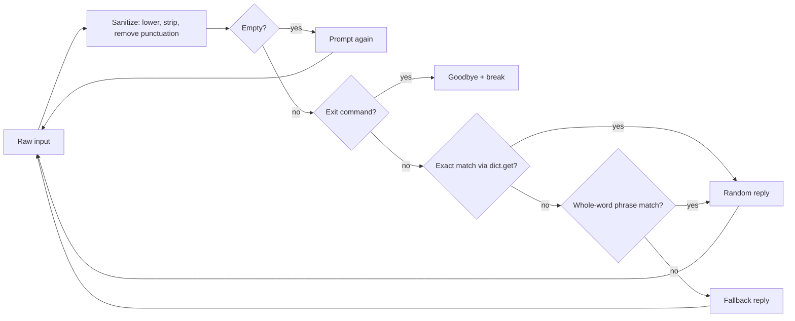

# DecodeBot: Rule-Based AI Chatbot

**DecodeLabs AI Industrial Training Kit, Batch 2026, Project 1**

A deterministic ("white box") chatbot built on explicit control flow and dictionary lookups. Every reply can be traced from input, through logic, to output. There is no model and no hallucination risk.

It ships in two interchangeable versions with identical rules:

| Version | File | Run it |
|---|---|---|
| Terminal (Python) | `chatbot.py` | `python chatbot.py` |
| Web UI (HTML/JS) | `index.html` | Double-click to open in a browser |

No installs or external packages are needed. The web UI shows a **"How it decided"** panel with the raw input, the sanitized text and the rule that fired for each message.

## Specification checklist

| Requirement | Implementation |
|---|---|
| Input loop: continuous `while` cycle | `while True` in `main()` |
| Sanitization: case and whitespace | `sanitize()`: `.lower().strip()` plus punctuation removal |
| Knowledge base: dictionary with 5+ intents | `responses` dict with 16 intents, several replies each |
| Fallback: default response for unknowns | `FALLBACK` message |
| Exit strategy: clean break command | `exit`, `quit`, `bye`, `goodbye`, `ok bye`, `see you`, Ctrl+C / Ctrl+D lead to `break` |
| Greetings and exit commands | `hello`, `hi`, `bye`, etc. |
| if-else logic for responses | Ordered decision chain in `get_reply()` |

## Architecture (IPO model)



## Design decisions

- **O(1) exact lookup first.** `responses.get(clean)` is tried before any scanning, as recommended in the training deck, and the loop over keys is only a second step.
- **Whole-word matching.** A naive `"hi" in text` test fires on "t**hi**s" and "w**hi**ch". Padding the text with spaces and matching `" hi "` avoids this, and a test covers it.
- **Name memory.** `my name is <name>` stores the name, and `who am i` recalls it.
- **Longest phrase wins.** "hi how are you" matches `how are you`, not `hi`.
- **Follow-up state.** After "how are you" the bot asks "And you?" and reads the next message as a mood (nested condition).
- **Guardrail.** Messages over 200 characters are blocked before matching.
- **Robust sanitizing.** Smart apostrophes, extra inner spaces and non-English letters are handled; a bare `my name is` asks for a name instead of failing; `call me` is deliberately not a trigger.
- **Randomised replies.** Several variants per intent, chosen with `random.choice`.
- **Time/date intent.** A dynamic reply built from `datetime`.

## Sample conversation (real output)

```
DecodeBot: Hi! Type 'exit' to quit.
You:   HELLO!!
DecodeBot: Hello! How can I help?
You: which one is this
DecodeBot: I do not understand. Type 'help' to see what I know.
You: my name is rahul
DecodeBot: Nice to meet you, Rahul!
You: who am i
DecodeBot: You're Rahul.
You: asdfgh
DecodeBot: I do not understand. Type 'help' to see what I know.
You: (empty)
DecodeBot: Say something, I'm listening!
You: Bye
DecodeBot: Goodbye!
```

The web UI (blueprint theme) shows the IPO pipeline lighting up per message and a live checklist of the project spec. Retake the screenshots in `docs/` after opening `index.html`.

## Testing

```
python -m unittest discover -s tests -v
```

The suite has 20 tests covering sanitization, exact, phrase and longest-phrase matching, the `hi`-inside-words bug, fallback, name memory edge cases (bare `my name is`, `call me`, too many words), time intents, the mood follow-up, the 200-character guardrail, the full loop, every exit command, and Ctrl+C / Ctrl+D. The JavaScript logic was checked against the Python version on the same inputs.

## Project structure

```
DecodeLabs_Project1/
├── chatbot.py          # terminal bot
├── index.html          # web UI (same logic in JavaScript)
├── tests/test_chatbot.py
├── README.md
└── .gitignore
```

## Publish on GitHub

1. Create a repository, e.g. `rule-based-chatbot`, and upload these files.
2. For a live demo: **Settings, Pages, Deploy from branch (`main`, `/root`)**. `index.html` is then served for free.

## Where this leads

Project 1 uses exact and whole-word matching (discrete keys). In Project 2 the keys become semantic embeddings (vectors), so "hey there" and "hello" match by meaning. The rule layer built here also serves as the deterministic guardrail layer in hybrid LLM systems.

## Possible extensions

Fuzzy matching with `difflib` for typos, nested follow-up conversations, a config file for intents, and a Streamlit front end.
